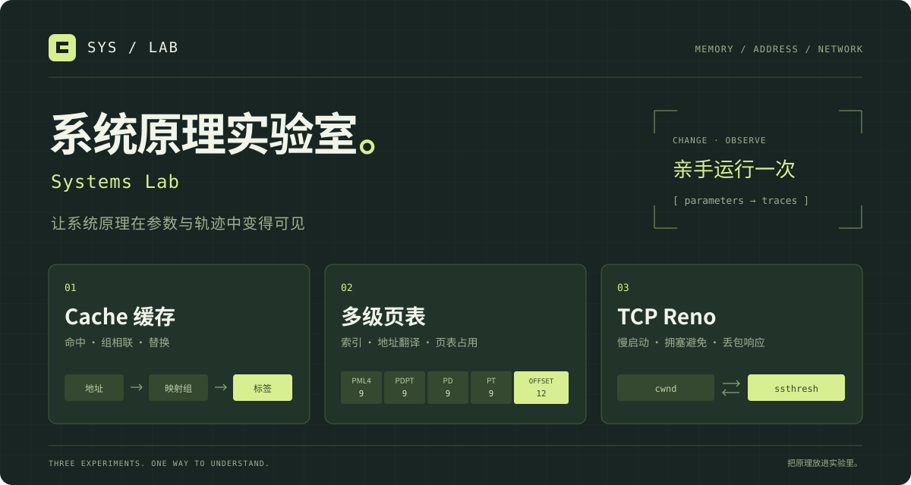

# Computer Systems Lab

[简体中文](README.md) · **English** · [Español](README.es.md) · [日本語](README.ja.md)

Explore cache mapping, x86-64 address translation, and TCP Reno by changing inputs, stepping through traces, and checking results by hand. The lab runs entirely in the browser; the interface is in Simplified Chinese.

**[Live lab](https://hokkaidoooo.github.io/cs-systems-lab/)** · [Model notes](docs/models.md) · [Cache comparison screenshot](docs/validation/cache-comparison.png) · [Reno on mobile](docs/validation/mobile-reno.png)

| Lab | What you can inspect | Model and code |
| --- | --- | --- |
| [Cache](https://hokkaidoooo.github.io/cs-systems-lab/#cache) | Hits, evictions, set contents, and step-by-step LRU classifications: compulsory, capacity, and conflict misses. | [Model](docs/models.md#cache) · [Code](src/models/cache.js) |
| [Paging](https://hokkaidoooo.github.io/cs-systems-lab/#paging) | 48- and 57-bit canonical addresses, 4 KiB/2 MiB/1 GiB pages, per-level indices, and page-table counts. | [Model](docs/models.md#paging) · [Code](src/models/paging.js) |
| [TCP Reno](https://hokkaidoooo.github.io/cs-systems-lab/#reno) | Slow start, congestion avoidance, and round-by-round effects of a timeout or three duplicate ACKs. | [Model](docs/models.md#reno) · [Code](src/models/reno.js) |

## Try the built-in examples

1. In Cache, compare `直接映射冲突` (direct-mapped conflict) and `4 路组相联` (4-way set associative). Both use 256 B, 16 B blocks, and the same eight accesses. Hits go from **0/8** to **5/8 (62.5%)**. Select a trace row to see whether it is a first access and whether an equal-size fully associative LRU cache would hit.
2. In Paging, compare `相邻的两个 4 KiB 页` (two adjacent 4 KiB pages) and `跨 512 GiB 的两个页` (two pages 512 GiB apart). The same number of mapped pages needs **4** or **7** page tables because the addresses share different prefixes.
3. In Reno, select `两种丢包对照` (compare two loss signals). Compare the window and threshold after three duplicate ACKs in round **10** and a timeout in round **20**.
4. In Cache, choose `LRU / FIFO 替换分歧` to replay both policies on one sequence. On access 6, LRU evicts block 1 and FIFO evicts block 0.
5. Click `生成完整实验链接` to create a share link restoring all three sets of inputs and the selected lab. Invalid links display an error.

## Run and test locally

No frontend packages are needed to use the lab. From the repository root, start a static server with Python 3 and open `http://127.0.0.1:4173`. Native ES modules require HTTP rather than `file://`.

```sh
python -m http.server 4173 --bind 127.0.0.1
```

Use Node.js 22 or newer for the checks. Install the development dependencies and Chromium for the browser suite, which also needs access to GitHub to check documentation navigation:

```sh
npm test
npm run check
npm ci
npx playwright install chromium
npm run test:browser
```

[`test/models.test.js`](test/models.test.js) covers examples and invalid inputs. The suite also checks seeded properties and share links, validates JavaScript and entry-point assets, and runs browser interactions including keyboard use and mobile layout. See [verification results](docs/optimization-validation.md).

## Check the numbers and know the limits

- **Cache:** Direct-mapped LRU with 4 B capacity and 1 B blocks gives two compulsory and two conflict misses for `0,4,0,4`. With a 2 B fully associative cache, the final access of `0,1,2,0` is a capacity miss. This is a single-level, read-only model. FIFO hit rates are comparable, but FIFO does not receive the LRU-based 3C labels.
- **Paging:** With 48-bit addresses and 4 KiB pages, mapping `0` and `0x8000000000` requires seven tables. A four-level walk on a TLB miss requires four table accesses and one data access when caching is ignored. A 2 MiB page splits the address into `9 + 9 + 9 + 21` bits and ends the walk at the PD; table pages still occupy 4 KiB each. The model assumes one address space and a uniform page size, with no permissions or page-fault handling.
- **Reno:** With window and threshold both at 16, three duplicate ACKs leave a window of 8 after recovery; a timeout gives a window of 1 and threshold of 8. The model aggregates by RTT and omits per-ACK behavior, transient inflation, and real throughput. There is no CUBIC or BBR comparison.

The calculations are in [src/models/](src/models/) and the interaction code is in [src/app.js](src/app.js). There are no accounts, analytics, remote computation, or uploads of learning activity. External documentation opens when selected.

## License

The code and original interface, graphics, and documentation are under the [MIT License](LICENSE). Linked references retain their own rights.
