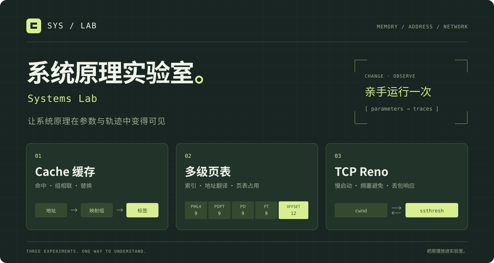

# Laboratorio de sistemas informáticos

[简体中文](README.md) · [English](README.en.md) · **Español** · [日本語](README.ja.md)

Experimenta con la asignación de caché, la traducción de direcciones x86-64 y TCP Reno. Puedes cambiar los parámetros, recorrer las trazas y comprobar las cifras a mano. El laboratorio se ejecuta íntegramente en el navegador y su interfaz está en chino simplificado.

**[Laboratorio en línea](https://hokkaidoooo.github.io/cs-systems-lab/)** · [Notas de los modelos](docs/models.md) · [Comparación de caché](docs/validation/cache-comparison.png) · [Reno en móvil](docs/validation/mobile-reno.png)

| Experimento | Qué puedes observar | Modelo y código |
| --- | --- | --- |
| [Caché](https://hokkaidoooo.github.io/cs-systems-lab/#cache) | Aciertos, reemplazos, estado de los conjuntos y fallos LRU clasificados paso a paso en obligatorios, de capacidad y de conflicto. | [Modelo](docs/models.md#cache) · [Código](src/models/cache.js) |
| [Paginación](https://hokkaidoooo.github.io/cs-systems-lab/#paging) | Direcciones canónicas de 48 o 57 bits, páginas de 4 KiB, 2 MiB o 1 GiB, índices por nivel y número de tablas. | [Modelo](docs/models.md#paging) · [Código](src/models/paging.js) |
| [TCP Reno](https://hokkaidoooo.github.io/cs-systems-lab/#reno) | Arranque lento, evitación de congestión y efectos por ronda de un timeout o tres ACK duplicados. | [Modelo](docs/models.md#reno) · [Código](src/models/reno.js) |

## Primer recorrido

1. En Caché, compara `直接映射冲突` (conflicto con correspondencia directa) y `4 路组相联` (asociativa por conjuntos de cuatro vías). Ambas usan 256 B, bloques de 16 B y ocho accesos iguales. Los aciertos pasan de **0/8** a **5/8 (62,5 %)**. Selecciona una fila para ver si es el primer acceso al bloque y si una caché LRU totalmente asociativa de igual capacidad acertaría.
2. En Paginación, compara `相邻的两个 4 KiB 页` (dos páginas adyacentes) y `跨 512 GiB 的两个页` (dos páginas separadas por 512 GiB). Dos páginas mapeadas requieren **4** o **7** tablas porque las direcciones comparten distintos prefijos.
3. En Reno, selecciona `两种丢包对照` (comparar dos señales de pérdida). Observa la ventana y el umbral tras tres ACK duplicados en la ronda **10** y un timeout en la **20**.
4. En Caché, `LRU / FIFO 替换分歧` reproduce una secuencia con ambas políticas. En el sexto acceso, LRU reemplaza el bloque 1 y FIFO el 0.
5. Pulsa `生成完整实验链接` para compartir los parámetros de los tres experimentos y el experimento activo. Si el enlace no es válido, aparece un error.

## Ejecución y pruebas locales

El laboratorio no necesita paquetes de frontend. Desde la raíz, inicia un servidor estático con Python 3 y abre `http://127.0.0.1:4173`. Los módulos ES nativos se sirven por HTTP, no con `file://`.

```sh
python -m http.server 4173 --bind 127.0.0.1
```

Las comprobaciones requieren Node.js 22 o posterior. La suite de navegador necesita instalar las dependencias de desarrollo y Chromium, y acceder a GitHub para comprobar la navegación a la documentación:

```sh
npm test
npm run check
npm ci
npx playwright install chromium
npm run test:browser
```

[`test/models.test.js`](test/models.test.js) cubre ejemplos calculados a mano y entradas inválidas. También se prueban propiedades con semilla fija y enlaces compartidos, se comprueban JavaScript y los recursos de entrada, y se verifican en el navegador el uso del teclado y el diseño móvil. Consulta los [resultados de verificación](docs/optimization-validation.md).

## Ejemplos comprobables y límites

- **Caché:** Una caché LRU de correspondencia directa, con 4 B de capacidad y bloques de 1 B, da dos fallos obligatorios y dos de conflicto en `0,4,0,4`. Con 2 B y asociación total, el último acceso de `0,1,2,0` es un fallo de capacidad. El modelo es de un nivel y solo lectura. Se pueden comparar los aciertos de FIFO, pero las etiquetas 3C se basan en LRU y no se aplican a FIFO.
- **Paginación:** Con 48 bits y páginas de 4 KiB, mapear `0` y `0x8000000000` requiere siete tablas. Un fallo de TLB en cuatro niveles implica cuatro accesos a tablas y uno a los datos, sin considerar la caché. Con páginas de 2 MiB, la división es `9 + 9 + 9 + 21` bits y el recorrido termina en PD. Las tablas siguen ocupando páginas de 4 KiB. El modelo usa un único espacio de direcciones y un tamaño uniforme, sin permisos ni gestión de fallos de página.
- **Reno:** Con ventana y umbral en 16, tres ACK duplicados dejan la ventana en 8 al terminar la recuperación; un timeout deja la ventana en 1 y el umbral en 8. El modelo resume por RTT y no simula cada ACK, el aumento transitorio de ventana ni el rendimiento real. Tampoco compara CUBIC o BBR.

Los cálculos están en [src/models/](src/models/) y la interacción en [src/app.js](src/app.js). No hay cuentas, analítica, cálculo remoto ni envío de registros de aprendizaje. Los enlaces a documentación externa se abren al seleccionarlos.

## Licencia

El código y la interfaz, los gráficos y la documentación originales se distribuyen bajo la [licencia MIT](LICENSE). Las referencias enlazadas conservan sus propios derechos.
