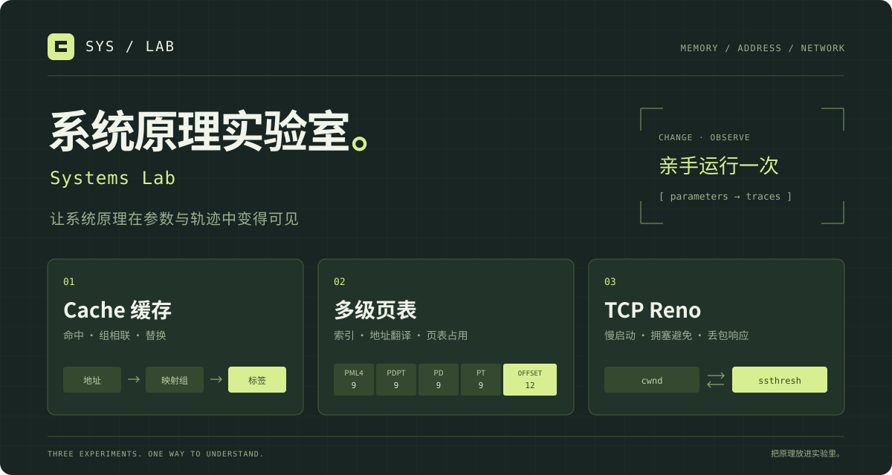

# コンピューターシステム実験室

[简体中文](README.md) · [English](README.en.md) · [Español](README.es.md) · **日本語**

キャッシュのマッピング、x86-64 のアドレス変換、TCP Reno を学ぶための実験ツールです。入力を変えてトレースを一歩ずつ追い、手計算と照らし合わせられます。すべての計算はブラウザー内で実行されます。画面表示は簡体字中国語です。

**[オンラインで試す](https://hokkaidoooo.github.io/cs-systems-lab/)** · [モデルの説明](docs/models.md) · [キャッシュ比較画面](docs/validation/cache-comparison.png) · [モバイルの Reno 画面](docs/validation/mobile-reno.png)

| 実験 | 観察できること | モデルと実装 |
| --- | --- | --- |
| [キャッシュ](https://hokkaidoooo.github.io/cs-systems-lab/#cache) | ヒット、置換、セットの状態、アクセスごとの LRU の 3C ミス分類。 | [モデル](docs/models.md#cache) · [実装](src/models/cache.js) |
| [ページング](https://hokkaidoooo.github.io/cs-systems-lab/#paging) | 48/57 ビットの正準アドレス、4 KiB/2 MiB/1 GiB ページ、各階層のインデックス、ページテーブルの枚数。 | [モデル](docs/models.md#paging) · [実装](src/models/paging.js) |
| [TCP Reno](https://hokkaidoooo.github.io/cs-systems-lab/#reno) | スロースタート、輻輳回避、タイムアウトと 3 回の重複 ACK によるラウンドごとの変化。 | [モデル](docs/models.md#reno) · [実装](src/models/reno.js) |

## はじめての実験

1. キャッシュで `直接映射冲突`（ダイレクトマップの競合）と `4 路组相联`（4 ウェイ・セットアソシアティブ）を比較します。容量 256 B、ブロック 16 B、同じ 8 回のアクセスで、ヒット数は **0/8** から **5/8（62.5%）** になります。トレースの行を選ぶと、初回アクセスか、同容量の完全連想 LRU でヒットするかを確認できます。
2. ページングで `相邻的两个 4 KiB 页`（隣接する 4 KiB ページ）と `跨 512 GiB 的两个页`（512 GiB 離れたページ）を比較します。マッピングはどちらも 2 ページですが、共有するアドレスの上位ビットが異なるため、テーブルは **4 枚**と **7 枚**になります。
3. Reno で `两种丢包对照`（2 種類の損失通知の比較）を選びます。**10** ラウンド目の 3 回の重複 ACK と **20** ラウンド目のタイムアウトについて、その後のウィンドウとしきい値を見比べます。
4. キャッシュで `LRU / FIFO 替换分歧` を選び、同じ列を両方の方式で再生します。6 回目のアクセスでは LRU がブロック 1 を、FIFO がブロック 0 を置換します。
5. `生成完整实验链接` で三つの実験の入力値と選択中の実験を共有できます。不正なリンクではエラーが表示されます。

## ローカルでの実行とテスト

実験の使用にはフロントエンドパッケージの導入が不要です。リポジトリのルートで Python 3 の静的サーバーを起動し、`http://127.0.0.1:4173` を開きます。ネイティブ ES モジュールを使うため、`file://` ではなく HTTP で開いてください。

```sh
python -m http.server 4173 --bind 127.0.0.1
```

チェックには Node.js 22 以上が必要です。ブラウザーテストには開発依存パッケージと Chromium を導入します。ドキュメントへの遷移確認には GitHub への接続も必要です。

```sh
npm test
npm run check
npm ci
npx playwright install chromium
npm run test:browser
```

[`test/models.test.js`](test/models.test.js) は手計算例と不正入力を検証します。固定シードによる性質テスト、共有リンク、JavaScript と入口のリソースのチェックに加え、キーボード操作やモバイル表示もブラウザーで確認します。[検証記録](docs/optimization-validation.md) を参照してください。

## 手計算例とモデルの範囲

- **キャッシュ：** 容量 4 B、ブロック 1 B のダイレクトマップ LRU で `0,4,0,4` にアクセスすると、最初の 2 回が初回参照によるミス、残り 2 回が競合ミスです。容量 2 B の完全連想では、`0,1,2,0` の最後が容量ミスになります。モデルは単一階層の読み取り専用です。FIFO のヒット率も比較できますが、LRU 基準の 3C 分類は FIFO には適用しません。
- **ページング：** 48 ビット・4 KiB ページで `0` と `0x8000000000` をマッピングすると、テーブルは 7 枚です。4 階層の TLB ミスでは、キャッシュを無視するとテーブルアクセス 4 回とデータアクセス 1 回が必要です。2 MiB ページでは `9 + 9 + 9 + 21` ビットに分かれ、PD で探索を終えます。テーブル自身は 4 KiB ページです。単一のアドレス空間と統一ページサイズを仮定し、権限やページフォールトは扱いません。
- **Reno：** ウィンドウとしきい値がともに 16 のとき、3 回の重複 ACK による回復後のウィンドウは 8 です。タイムアウトならウィンドウは 1、しきい値は 8 です。RTT ごとのモデルで、ACK 単位の挙動、一時的なウィンドウ拡大、実効スループットや CUBIC/BBR との比較は扱いません。

計算は [src/models/](src/models/)、画面操作は [src/app.js](src/app.js) にあります。アカウント、利用追跡、サーバーでの計算、学習記録の送信はありません。外部のドキュメントはリンクを選んだときに開きます。

## ライセンス

コードおよび独自の画面、図版、説明文は [MIT License](LICENSE) で提供します。参照先の資料にはそれぞれの権利が適用されます。
