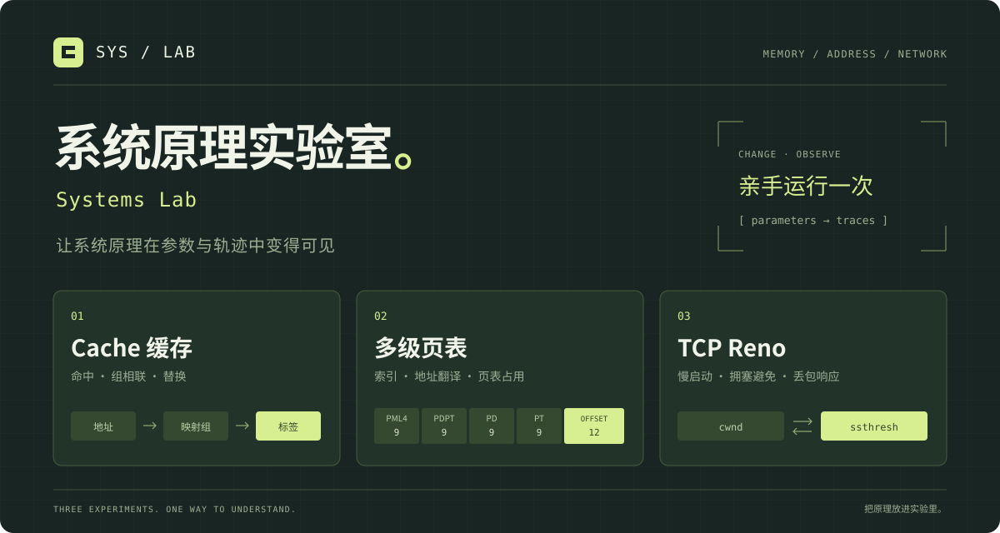

# 系统原理实验室

通过改参数、看轨迹、核对数值，理解 Cache 映射、x86-64 地址翻译与 TCP Reno。

**[在线体验](https://hokkaidoooo.github.io/cs-systems-lab/)** · [模型与边界](docs/models.md) · [测试用例](test/models.test.js)

| 实验入口 | 可以观察什么 | 模型与实现 |
| --- | --- | --- |
| [Cache](https://hokkaidoooo.github.io/cs-systems-lab/#cache) | 命中、替换、各组状态及访问轨迹；LRU 的 3C 缺失分类 | [模型](docs/models.md#cache) · [计算函数](src/models/cache.js) |
| [页表](https://hokkaidoooo.github.io/cs-systems-lab/#paging) | 48/57 位规范地址、4 KiB/2 MiB/1 GiB 页、逐级索引、页表页数 | [模型](docs/models.md#paging) · [计算函数](src/models/paging.js) |
| [TCP Reno](https://hokkaidoooo.github.io/cs-systems-lab/#reno) | 慢开始、拥塞避免、超时与三次重复 ACK 的轮次轨迹 | [模型](docs/models.md#reno) · [计算函数](src/models/reno.js) |

## 第一次体验

1. 打开 **Cache**，依次选择“直接映射冲突”和“4 路组相联”。两者使用相同的 256 B 容量、16 B 块和 8 次访问；命中次数应从 **0/8** 变成 **5/8（62.5%）**。在轨迹表中查看同组替换发生在哪一步。
2. 打开 **页表**，比较“相邻的两个 4 KiB 页”和“跨 512 GiB 的两个页”。同为两个映射页，页表数量应分别为 **4 张**和 **7 张**；区别来自地址前缀能够共享的层数。
3. 打开 **TCP Reno**，选择“两种丢包对照”。在逐轮轨迹中找到第 **10** 轮的三次重复 ACK 和第 **20** 轮的超时，对比事件后的窗口与阈值。
4. 在 Cache 选择“LRU / FIFO 替换分歧”，两侧按同一访问步骤回放。第 6 次访问时，LRU 替换块 1，FIFO 替换块 0。
5. 点击“生成完整实验链接”，复制链接即可恢复三个实验的参数和当前实验。非法链接会显示错误，不会悄悄换成默认参数。

## 运行

无需安装前端依赖。在仓库根目录使用 Python 3 启动静态服务：

```sh
python -m http.server 4173 --bind 127.0.0.1
```

打开 <http://127.0.0.1:4173>。页面采用原生 ES modules，请通过 HTTP 访问。

运行测试需要 Node.js 22 或更新版本：

```sh
npm test
npm run check
npm ci
npx playwright install chromium
npm run test:browser
```

`npm test` 运行手算例、固定种子性质和分享格式测试；`npm run check` 检查 JavaScript 语法与入口资源；`npm run test:browser` 真实操作预设、策略对照、分享链接、键盘与移动布局，并打开排版后的文档。后者需要浏览器和 GitHub 网络连接。

## 可以核对的例子

- **分页**：48 位地址、4 KiB 页，映射 `0` 和 `0x8000000000`，需要 7 张页表；四级页表在 TLB 未命中、忽略缓存命中时，需要 4 次页表访问加 1 次数据访问。
- **大页**：48 位地址使用 2 MiB 页时，索引拆分为 `9 + 9 + 9 + 21`，到 PD 层终止；页表本身仍按 4 KiB 一页计算。
- **Reno**：窗口和阈值均为 16 时，三次重复 ACK 后的恢复完成窗口为 8；超时则将窗口置为 1、阈值置为 8。

测试包含这些手算例、非法输入和数据不变性检查。测试通过只支持所列模型与场景，不证明覆盖了真实硬件或网络栈的全部行为。

## 模型范围

- Cache 是单级只读访问模型。FIFO 的命中统计可以比较，但不套用 LRU 影子基准的 3C 标签。
- 分页假设单个地址空间使用统一页大小，仅统计给定映射集合需要的页表；不模拟页权限、缺页处理或混合页大小。
- Reno 按 RTT 汇总，呈现快速恢复完成后的窗口；不模拟逐 ACK 行为、瞬态窗口膨胀或实际链路吞吐，不提供 CUBIC/BBR 性能比较。
- 所有计算在页面内完成，没有账号、AI 接口、统计追踪或学习记录上传。文档链接需要用户主动打开。

详细公式、参数上限、输入契约和参考资料见 [模型说明](docs/models.md)。

## 来源与目录

项目来源于个人 408 学习工具，使用 AI 编程工具辅助实现。当前版本将计算模型与页面交互分开：

| 位置 | 内容 |
| --- | --- |
| [src/models/](src/models/) | 三个实验的纯计算函数与输入校验 |
| [src/app.js](src/app.js) | 参数表单、预设、轨迹展示与模块切换 |
| [test/models.test.js](test/models.test.js) | 手算例、非法输入和数据不变性测试 |
| [docs/models.md](docs/models.md) | 模型假设、参数边界与参考资料 |

仓库不包含考试大纲原文、教材、题库、第三方文章、个人笔记或原学习站的 AI 配置。界面、图形和文档随代码提供；没有捆绑第三方运行时库。

## 验收记录

已提供实验参数分享、同序列 LRU/FIFO 对照、固定种子性质测试和浏览器操作测试。实际场景、命令及本轮截图见 [技术优化验收记录](docs/optimization-validation.md)。

发现问题时，请附所用参数、操作步骤、预期数值与实际结果。关于模型适用范围的讨论同样欢迎。

## 许可

代码与本仓库原创界面、图形、说明采用 [MIT License](LICENSE)。外部参考资料保留其各自权利，链接不代表再分发授权。
